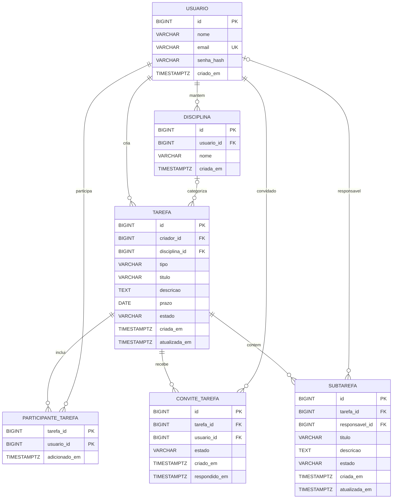
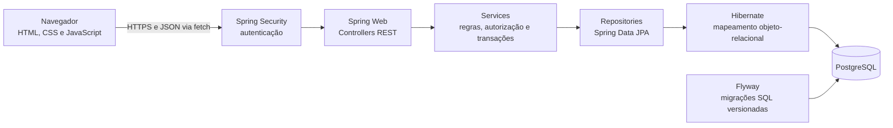

# Plataforma de Organização Acadêmica

> **Status:** proposta inicial do produto. O escopo descrito aqui ainda precisa ser validado com estudantes antes de orientar a implementação.

## 1. Objetivo do sistema

Oferecer a estudantes um espaço web para organizar atividades acadêmicas individuais e em grupo, acompanhar prazos e dividir trabalhos em subtarefas com responsáveis e progresso visíveis para as pessoas autorizadas.

O sistema deve ajudar cada estudante a entender o que precisa ser feito, até quando e por quem, preservando a responsabilidade principal de quem criou uma tarefa compartilhada.

## 2. Problema que pretende resolver

### Hipótese do problema

Estudantes podem organizar compromissos acadêmicos usando várias ferramentas — por exemplo, calendários, listas pessoais, planilhas e conversas em grupo. Essa dispersão pode dificultar a visualização dos prazos, a divisão de trabalhos e o acompanhamento de responsabilidades, contribuindo para tarefas esquecidas ou trabalho mal distribuído.

Essa descrição é uma hipótese de produto, ainda não uma conclusão de pesquisa. Precisamos confirmar com estudantes se o problema ocorre com frequência, quais ferramentas já usam e o que realmente sentem falta nelas.

## 3. Perfis de usuários

Os perfis abaixo são papéis dentro do produto, não necessariamente tipos diferentes de conta.

### Estudante responsável pela tarefa

Cria uma atividade individual ou compartilhada. Em uma tarefa compartilhada, é o responsável principal e administra seus dados centrais, participantes e subtarefas.

### Estudante participante

Tem acesso a uma tarefa compartilhada da qual participa. Pode visualizar seus dados e atualizar o progresso das subtarefas que lhe foram atribuídas.

### Estudante com tarefa individual

Organiza uma atividade própria. Somente seu criador pode acessá-la, conforme as regras de negócio da seção 4.

**Fora dos perfis iniciais:** professores, coordenadores, administradores institucionais e pessoas sem conta não têm papéis definidos para o MVP.

## 4. Regras de negócio e autorização

As regras desta seção definem o comportamento proposto para o MVP. O back-end deve aplicá-las em cada operação; esconder uma ação na interface não é controle de acesso.

### 4.1 Tipos de tarefa e papéis

- **Tarefa individual:** pertence à pessoa que a criou. Somente ela pode visualizar ou alterar a tarefa e suas subtarefas. Não aceita participantes nem convites. Uma subtarefa pode ficar sem responsável ou ser atribuída ao criador.
- **Tarefa compartilhada:** tem exatamente um responsável principal, que é seu criador. O responsável principal não pode ser removido nem transferido no MVP. O tipo da tarefa também não pode ser convertido depois da criação.
- **Participante:** só passa a ter acesso depois de aceitar o convite. Enquanto o convite está pendente, não pode consultar a tarefa. Uma tarefa compartilhada continua existindo mesmo se ficar sem participantes além do criador.
- **Responsável por subtarefa:** pode ser o criador ou um participante atual da tarefa. Uma subtarefa também pode ficar sem responsável.

### 4.2 Matriz de permissões

A pessoa responsável por uma subtarefa tem permissão para atualizar o progresso dela. Se essa pessoa for participante, recebe essa permissão adicional às de participante; o criador mantém as permissões administrativas da tarefa.

| Ação | Criador / responsável principal | Participante sem subtarefa atribuída | Participante responsável pela subtarefa |
| --- | --- | --- | --- |
| Consultar tarefa compartilhada e subtarefas | Sim | Sim | Sim |
| Alterar dados centrais, inclusive título e prazo | Sim, se a tarefa estiver aberta | Não | Não |
| Convidar ou remover participantes em tarefa compartilhada aberta | Sim | Não | Não |
| Criar, editar, atribuir, reatribuir ou excluir subtarefas | Sim, se a tarefa estiver aberta | Não | Não |
| Atualizar o progresso de qualquer subtarefa | Sim, se a tarefa estiver aberta | Não | Não |
| Atualizar o progresso de uma subtarefa atribuída à própria pessoa | Sim | Não | Sim, se a tarefa estiver aberta |
| Concluir ou reabrir a tarefa | Sim | Não | Não |
| Excluir a tarefa | Sim, aberta ou concluída | Não | Não |
| Consultar tarefa individual | Sim, se for sua criadora | Não | Não se aplica |

### 4.3 Convites e remoção de participantes

- Somente o criador pode convidar ou remover participantes enquanto a tarefa compartilhada estiver aberta. Participantes não podem convidar outras pessoas nem remover a si próprios no MVP.
- O convite é enviado a uma conta existente e precisa ser aceito. A pessoa convidada pode aceitar ou recusar; o criador pode cancelar um convite pendente. Convites pendentes não expiram automaticamente no MVP.
- Uma pessoa que já participa ou já tem convite pendente não pode receber outro convite para a mesma tarefa. Convites recusados ou cancelados podem ser enviados novamente; uma pessoa removida pode voltar somente após receber e aceitar novo convite.
- Ao remover um participante, o acesso à tarefa é revogado imediatamente e qualquer convite pendente dessa pessoa é cancelado.
- Subtarefas atribuídas à pessoa removida ficam sem responsável. O estado de progresso já registrado é mantido; o criador pode atribuí-las a si ou a outro participante atual.
- A remoção não apaga a tarefa nem as subtarefas. O criador continua responsável principal, mesmo se for a única pessoa com acesso.

### 4.4 Atribuição e progresso de subtarefas

- Somente o criador pode criar, editar, atribuir e reatribuir subtarefas. A pessoa atribuída deve ser o próprio criador ou um participante atual da tarefa compartilhada.
- Reatribuir uma subtarefa não altera seu progresso. Se a pessoa atribuída for removida da tarefa, a subtarefa fica sem responsável e conserva o progresso atual.
- O progresso de uma subtarefa tem três estados no MVP: **Pendente**, **Em andamento** e **Concluída**. O criador pode alterar o estado de qualquer subtarefa; um participante pode alterar somente o estado da subtarefa atribuída a si.
- O progresso pode voltar de **Concluída** para **Em andamento** ou **Pendente** enquanto a tarefa estiver aberta, para permitir correções.

### 4.5 Conclusão, reabertura e exclusão

- A tarefa tem dois estados: **Aberta** e **Concluída**. Cancelamento não é um estado disponível no MVP.
- Somente o criador pode concluir uma tarefa. Se houver subtarefas, todas devem estar **Concluídas**. Se não houver subtarefas, o criador pode concluí-la diretamente. A conclusão da tarefa não ocorre automaticamente quando as subtarefas terminam.
- Ao concluir uma tarefa, convites ainda pendentes são cancelados e não podem ser aceitos. Para incluir alguém depois, o criador precisa reabrir a tarefa e enviar um novo convite.
- Uma tarefa concluída fica bloqueada para alterações de dados, participantes, subtarefas e progresso. Somente o criador pode reabri-la ou excluí-la. Ao reabrir, os estados de progresso existentes são preservados e as alterações voltam a ser permitidas.
- Somente o criador pode excluir uma subtarefa, e somente enquanto a tarefa estiver aberta. A exclusão remove a subtarefa sem recuperação. Excluir uma subtarefa não conclui automaticamente a tarefa.
- Somente o criador pode excluir uma tarefa. A exclusão é definitiva e também remove suas subtarefas, participantes e convites pendentes. A interface deve pedir confirmação antes de concluir essa operação.

### 4.6 Regras de autorização no back-end

- Toda operação exige autenticação. Sem autenticação, a requisição é rejeitada.
- A identidade autenticada no servidor determina quem está fazendo a operação. O sistema não deve confiar em IDs de criador, participante ou responsável enviados pelo cliente para conceder acesso ou definir autoria.
- O servidor verifica a permissão para cada leitura e alteração, incluindo operações em subtarefas e convites. Para uma subtarefa, também verifica se ela pertence à tarefa indicada e se a pessoa tem acesso à tarefa.
- A autorização é negada por padrão. Alterações feitas por participante não podem modificar campos administrativos, participantes, atribuições ou progresso de subtarefas alheias, mesmo que esses campos sejam enviados diretamente à API.
- A permissão é verificada no momento da alteração. Uma pessoa removida não pode continuar alterando a tarefa usando uma sessão ou tela que já estava aberta.
- A API responde com HTTP 401 quando falta autenticação; com HTTP 404 para recurso inexistente ou inacessível, sem revelar seus dados; e com HTTP 403 para uma ação proibida em uma tarefa que a pessoa pode visualizar.
- A checagem de permissão e a alteração devem ser consistentes: se o acesso tiver sido revogado, a operação não pode persistir usando permissões antigas.

## 5. Funcionalidades essenciais do MVP

O MVP deve validar o fluxo básico de organização e colaboração, sem tentar substituir plataformas acadêmicas completas.

1. **Conta e acesso:** cadastrar-se e entrar com uma conta de estudante.
2. **Tarefas:** criar, consultar e editar tarefas individuais e compartilhadas, incluindo ao menos título e prazo. A descrição pode ser incluída se estudantes confirmarem sua utilidade.
3. **Listagem:** ver tarefas próprias e tarefas compartilhadas das quais a pessoa participa, organizadas de forma que os próximos prazos sejam fáceis de encontrar.
4. **Colaboração:** o responsável principal pode adicionar e remover participantes de uma tarefa compartilhada.
5. **Subtarefas:** o responsável pode criar subtarefas, associar cada uma a uma pessoa participante e administrar sua organização.
6. **Progresso:** o responsável pode acompanhar as subtarefas; cada participante pode atualizar o progresso apenas das subtarefas atribuídas a si.
7. **Autorização:** impedir no back-end acessos e alterações incompatíveis com o papel da pessoa, inclusive quando uma requisição é enviada diretamente à API.
8. **Validação e erros:** validar dados obrigatórios e apresentar mensagens compreensíveis para dados inválidos, tarefa inexistente ou falta de permissão.

### Critério de sucesso inicial

Um pequeno grupo de estudantes consegue criar uma tarefa compartilhada, incluir colegas, dividir o trabalho em subtarefas, atribuí-las e acompanhar o progresso sem depender de uma conversa separada para descobrir quem é responsável pelo quê. A facilidade e a utilidade desse fluxo ainda precisam ser avaliadas com usuários.

## 6. Funcionalidades fora da primeira versão

Para manter o MVP pequeno, ficam fora do escopo inicial, salvo se a pesquisa mostrar que algum item é indispensável:

- Aplicativos nativos para celular e funcionamento sem conexão.
- Integração com calendários, ambientes virtuais de aprendizagem ou sistemas de instituições.
- Notificações por e-mail, push ou mensagens; regras de lembrete e notificações ainda não foram definidas.
- Chat, comentários, anexos e armazenamento de arquivos.
- Recorrência de tarefas, templates e criação automática a partir de disciplinas.
- Papéis de professor, turma institucional, notas e acompanhamento de desempenho acadêmico.
- Relatórios avançados de carga de trabalho, produtividade ou contribuição individual.
- Recomendações automáticas ou recursos de inteligência artificial.
- Workflows de aprovação, permissões configuráveis por tarefa ou outros controles avançados.

## 7. Requisitos funcionais

Os requisitos seguintes descrevem a proposta do MVP. Itens marcados como **a validar** dependem de decisão dos estudantes ou do responsável pelo produto.

| ID | Requisito |
| --- | --- |
| RF-01 | O sistema deve permitir que uma pessoa crie uma conta e autentique-se. **A validar:** quais dados de cadastro são necessários e se o acesso será por senha, provedor externo ou ambos. |
| RF-02 | Uma pessoa autenticada deve poder criar uma tarefa individual ou compartilhada. |
| RF-03 | Toda tarefa deve ter um responsável principal, definido como a pessoa que a criou. No MVP, o responsável principal e o tipo da tarefa não podem ser alterados. |
| RF-04 | Somente o criador pode consultar e alterar os dados centrais de sua tarefa. A exclusão é definitiva e remove subtarefas, participantes e convites pendentes. Tarefas concluídas precisam ser reabertas antes de alterar seus dados, participantes ou subtarefas; somente o criador pode excluí-las sem reabrir. |
| RF-05 | Uma pessoa deve poder listar suas tarefas individuais e as tarefas compartilhadas às quais tem acesso. |
| RF-06 | Somente o responsável principal pode convidar ou remover participantes enquanto a tarefa compartilhada estiver aberta. O convite precisa ser aceito; a remoção revoga o acesso imediatamente, cancela convite pendente e deixa sem responsável as subtarefas da pessoa removida, preservando o progresso. Ao concluir a tarefa, convites pendentes são cancelados. |
| RF-07 | O responsável principal pode criar, editar, reatribuir e remover subtarefas enquanto a tarefa estiver aberta. |
| RF-08 | Cada subtarefa pode ficar sem responsável ou ser atribuída pelo responsável principal a si mesmo ou a um participante atual da tarefa. |
| RF-09 | Uma pessoa participante deve poder consultar as tarefas compartilhadas às quais foi adicionada. |
| RF-10 | O responsável principal pode atualizar o progresso de qualquer subtarefa; um participante pode atualizar somente a subtarefa atribuída a si. O progresso tem os estados Pendente, Em andamento e Concluída. |
| RF-11 | O sistema deve negar no servidor qualquer leitura ou alteração feita por pessoa sem a permissão correspondente. |
| RF-12 | O sistema deve informar quando uma operação falhar por dados inválidos, recurso não encontrado ou permissão insuficiente, sem revelar dados de tarefas não autorizadas. |
| RF-13 | A listagem deve permitir identificar tarefas próximas do prazo. **A validar:** filtros, ordenação e estados que estudantes precisam ver. |
| RF-14 | Somente o responsável principal pode concluir ou reabrir a tarefa. Para concluir, todas as subtarefas devem estar concluídas; uma tarefa sem subtarefas pode ser concluída diretamente. A conclusão não é automática. |

## 8. Requisitos não funcionais

| ID | Requisito |
| --- | --- |
| RNF-01 | **Segurança:** autenticação e autorização devem ser aplicadas no back-end; credenciais devem ser armazenadas usando mecanismos apropriados de proteção, nunca em texto puro. |
| RNF-02 | **Privacidade:** dados de tarefas devem ser acessíveis somente às pessoas autorizadas, seguindo o princípio de conceder o menor acesso necessário. |
| RNF-03 | **Integridade:** operações que alterem tarefa, participantes ou subtarefas devem preservar relacionamentos válidos e não deixar dados em estado inconsistente. |
| RNF-04 | **Usabilidade:** os fluxos principais — criar tarefa, dividir em subtarefas e atualizar progresso — devem ser compreensíveis para estudantes sem treinamento. |
| RNF-05 | **Compatibilidade:** a interface web deve funcionar nos navegadores modernos definidos para o projeto. **A validar:** suporte mínimo a celulares e navegadores específicos. |
| RNF-06 | **Manutenibilidade:** o back-end deve usar Java 21, Spring Boot e um monólito modular organizado por domínios, com separação clara entre controllers, services, repositories, entities e DTOs. |
| RNF-07 | **Persistência e evolução:** PostgreSQL será o banco previsto; mudanças de esquema devem ser versionadas com Flyway. |
| RNF-08 | **Qualidade:** regras importantes de negócio e autorização devem ter testes automatizados adequados, usando JUnit Jupiter, Mockito e Spring Boot Test quando fizer sentido. |
| RNF-09 | **Configuração segura:** segredos e credenciais não devem ser incluídos no repositório; configurações de ambiente devem permitir executar a aplicação sem expor esses valores. |
| RNF-10 | **Desempenho e disponibilidade:** metas quantitativas ainda não foram definidas. Devem ser estabelecidas depois de estimar quantidade de usuários, volume de dados e ambiente de hospedagem. |
| RNF-11 | **Acessibilidade e idioma:** o idioma inicial e o nível de acessibilidade esperado ainda precisam ser definidos e avaliados com usuários. |

## 9. Decisões e requisitos a validar com estudantes

Estas perguntas devem orientar entrevistas curtas e testes de protótipo. As respostas podem mudar a priorização e o escopo do MVP.

### Problema e hábitos atuais

- Como estudantes registram hoje trabalhos, provas e prazos? Quais ferramentas usam juntos?
- Quando foi a última vez que perderam um prazo ou tiveram dificuldade de acompanhar uma atividade? O que aconteceu?
- O problema mais frequente é lembrar prazos, dividir trabalho, saber o andamento ou outro?
- Já usam uma ferramenta que resolve parte disso? O que funciona e o que falta?

### Tarefas e informações

- Quais tipos de atividade devem ser organizados: trabalhos, provas, leituras, apresentações ou outros?
- Além de título e prazo, quais dados são indispensáveis? Por exemplo, disciplina, descrição, link ou prioridade.
- Os rótulos **Pendente**, **Em andamento** e **Concluída** são claros para estudantes? Eles precisam de algum estado adicional no MVP?
- Faz sentido exigir que todas as subtarefas estejam concluídas antes de concluir a tarefa? Para tarefas sem subtarefas, a conclusão direta pelo criador é suficiente?
- A exclusão definitiva da tarefa, junto com participantes e subtarefas, corresponde às expectativas? Seria necessário arquivar ou recuperar itens excluídos?
- Estudantes precisam de um estado **Cancelada** para atividades que não serão realizadas?

### Grupos e responsabilidades

- Como identificar e adicionar colegas: nome de usuário, e-mail, link de convite ou código?
- O fluxo do MVP — convite enviado somente pelo criador, com aceite do convidado — atende aos grupos de estudantes?
- O que estudantes esperam que aconteça com o progresso quando uma pessoa removida deixa subtarefas sem responsável?
- Participantes precisam poder sair voluntariamente de uma tarefa, além de poderem ser removidos pelo criador?
- Como estudantes percebem uma divisão de trabalho injusta? É necessário mostrar carga por participante no MVP?

### Uso e prioridade

- O acesso pelo celular é necessário desde a primeira versão?
- Lembretes de prazo são essenciais? Se sim, por qual canal e com quanta antecedência?
- É necessário vincular tarefas a disciplinas e semestres?
- Quais integrações, se alguma, são necessárias para que estudantes adotem o produto?
- Que informação ou resultado faria estudantes voltar a usar o sistema toda semana?

### Privacidade e conta

- A regra de tarefas individuais privadas corresponde às expectativas dos estudantes?
- Quais dados pessoais são realmente necessários para criar uma conta?
- O que a pessoa espera que aconteça com seus dados quando encerra a conta?

## 10. Principais casos de uso

Os fluxos abaixo detalham como os perfis propostos usam o MVP. Quando uma regra ainda não foi definida, ela aparece como **proposta a validar** e não deve ser tratada como decisão fechada.

### Atores

- **Estudante:** pessoa com conta que usa a plataforma.
- **Responsável principal:** estudante que criou a tarefa e administra seus dados, participantes e subtarefas.
- **Participante:** estudante que aceitou ou recebeu acesso a uma tarefa compartilhada.
- **Estudante convidado:** pessoa que recebeu um convite para participar de uma tarefa.

Responsável principal, participante e estudante convidado são papéis que um mesmo estudante pode exercer em tarefas diferentes.

### UC-01 — Cadastrar conta

**Ator principal:** estudante não cadastrado.

**Pré-condição:** a pessoa ainda não possui uma conta com o identificador informado.

**Fluxo principal:**

1. A pessoa abre a tela de cadastro.
2. Informa os dados exigidos pelo formulário.
3. O sistema valida os dados e verifica se o identificador já está em uso.
4. O sistema cria a conta e informa que o cadastro foi concluído.

**Exceções:** dados obrigatórios ausentes ou inválidos; identificador já cadastrado; falha ao salvar a conta.

**A validar:** quais dados são necessários, se o cadastro usa e-mail e senha e se é necessária confirmação de e-mail.

### UC-02 — Autenticar-se

**Ator principal:** estudante cadastrado.

**Pré-condição:** a conta existe e está habilitada.

**Fluxo principal:**

1. A pessoa abre a tela de acesso e informa suas credenciais.
2. O sistema valida as credenciais.
3. O sistema inicia uma sessão autenticada e mostra as tarefas às quais a pessoa tem acesso.

**Exceções:** credenciais incorretas; conta inexistente ou indisponível; falha temporária de autenticação. A mensagem não deve revelar se um identificador específico possui conta.

**Decisão tomada:** cadastro local por e-mail e senha. **A validar:** necessidade de confirmação de e-mail e recuperação de senha.

### UC-03 — Gerenciar disciplinas

**Ator principal:** estudante autenticado.

**Pré-condição:** a pessoa está autenticada.

**Fluxo principal:**

1. A pessoa abre sua lista de disciplinas.
2. Cria uma disciplina informando ao menos seu nome.
3. Pode consultar, editar ou remover disciplinas que administra.
4. Ao criar ou editar uma tarefa, pode associá-la a uma disciplina, se essa associação for confirmada para o MVP.

**Exceções:** nome ausente ou inválido; tentativa de alterar disciplina de outra pessoa; tentativa de remover uma disciplina que ainda esteja associada a tarefas — o comportamento nesse caso precisa ser definido.

**Proposta a validar:** cada estudante mantém sua própria lista de disciplinas. Também falta definir campos adicionais, como período ou instituição, e como a disciplina aparece para participantes de uma tarefa compartilhada.

### UC-04 — Criar tarefa individual

**Ator principal:** estudante autenticado, que será o responsável principal.

**Pré-condição:** a pessoa está autenticada; a disciplina pode ser associada se já existir e se essa relação fizer parte do MVP.

**Fluxo principal:**

1. A pessoa escolhe criar uma tarefa individual.
2. Informa título e prazo, além de outros campos que venham a ser definidos.
3. Opcionalmente associa uma disciplina.
4. Salva a tarefa.
5. O sistema registra a pessoa como responsável principal e disponibiliza a tarefa somente a ela.

**Exceções:** título ou prazo ausente ou inválido; disciplina inexistente ou à qual a pessoa não tem acesso; falha ao salvar.

### UC-05 — Criar tarefa compartilhada

**Ator principal:** estudante autenticado, que será o responsável principal.

**Pré-condição:** a pessoa está autenticada.

**Fluxo principal:**

1. A pessoa escolhe criar uma tarefa compartilhada.
2. Informa título e prazo e, se aplicável, associa uma disciplina.
3. Salva a tarefa.
4. O sistema registra a pessoa criadora como responsável principal.
5. A tarefa fica visível ao criador; outras pessoas passam a vê-la quando receberem acesso conforme o fluxo de convite.

**Exceções:** dados obrigatórios ausentes ou inválidos; disciplina sem acesso; falha ao salvar. Se a pessoa não tiver permissão para administrar a tarefa, o sistema rejeita a operação.

### UC-06 — Convidar participante

**Atores:** responsável principal e estudante convidado.

**Pré-condição:** existe uma tarefa compartilhada aberta que o responsável principal pode administrar.

**Fluxo principal:**

1. O responsável abre a tarefa e escolhe convidar alguém.
2. Informa um identificador de uma conta existente, como o e-mail ou nome de usuário.
3. O sistema cria um convite pendente.
4. O estudante convidado consulta o convite dentro da plataforma e aceita ou recusa.
5. Se aceitar, o sistema registra a participação e permite consultar a tarefa. Se recusar, encerra o convite e não concede acesso.

**Exceções:** conta não encontrada; pessoa já participante; convite já pendente; convite recusado ou cancelado; tarefa concluída; tentativa de convidar feita por alguém que não é o responsável principal; tarefa não compartilhada.

**A validar:** identificador usado para localizar colegas e se a ausência de expiração automática é adequada para convites pendentes.

### UC-07 — Gerenciar subtarefas

**Ator principal:** responsável principal.

**Pré-condição:** existe uma tarefa aberta que a pessoa pode administrar; para atribuir uma subtarefa, o responsável escolhido é o criador ou um participante atual.

**Fluxo principal:**

1. O responsável abre a tarefa.
2. Cria uma subtarefa com as informações necessárias.
3. Opcionalmente atribui a subtarefa a si ou a um participante autorizado.
4. Pode editar, reatribuir ou remover subtarefas enquanto a tarefa estiver aberta.
5. O sistema atualiza a visão da tarefa para as pessoas autorizadas.

**Exceções:** tentativa de gerenciamento por participante sem permissão; tarefa inexistente ou inacessível; tarefa concluída (o criador precisa reabri-la); pessoa escolhida não pertence à tarefa; dados inválidos.

### UC-08 — Atualizar progresso de subtarefa

**Atores:** responsável principal ou participante a quem a subtarefa foi atribuída.

**Pré-condição:** a pessoa está autenticada e a tarefa está aberta. Se for participante, precisa ter acesso à tarefa e ser responsável pela subtarefa.

**Fluxo principal:**

1. A pessoa abre a tarefa e seleciona uma subtarefa.
2. O responsável principal pode atualizar o progresso de qualquer subtarefa; um participante só pode atualizar a subtarefa atribuída a si.
3. A pessoa seleciona Pendente, Em andamento ou Concluída.
4. O sistema valida a permissão e salva a alteração.
5. As pessoas autorizadas podem consultar o progresso atualizado.

**Exceções:** participante tenta alterar subtarefa não atribuída a si; tarefa ou subtarefa removida; tarefa concluída; pessoa sem acesso à tarefa; estado de progresso inválido; falha ao salvar.

### UC-09 — Consultar tarefas e prazos

**Ator principal:** estudante autenticado.

**Pré-condição:** a pessoa está autenticada.

**Fluxo principal:**

1. A pessoa abre sua lista de tarefas.
2. O sistema apresenta suas tarefas individuais e as tarefas compartilhadas às quais ela tem acesso, com os respectivos prazos.
3. A pessoa abre uma tarefa para consultar seus dados e subtarefas, conforme suas permissões.
4. A pessoa identifica tarefas próximas do prazo; ordenação e filtros podem ser oferecidos conforme o escopo confirmado.

**Exceções:** nenhuma tarefa cadastrada — o sistema apresenta uma lista vazia com orientação para criar a primeira; tarefa inexistente ou sem permissão — o sistema não revela seus dados; falha ao consultar os dados.

**A validar:** filtros necessários, ordenação padrão e como destacar tarefas atrasadas ou concluídas.

## 11. Proposta de modelo relacional

Este modelo lógico para PostgreSQL mantém criador, participantes aceitos e convites pendentes como conceitos separados. A migration `V1` implementa somente `usuario`; as demais entidades descritas aqui continuam como proposta até suas decisões pendentes serem validadas. Os nomes físicos usam `snake_case`.

### 11.1 Diagrama ER



Em `participante_tarefa`, `tarefa_id` e `usuario_id` formam juntos a chave primária composta e também são chaves estrangeiras. A chave estrangeira de `tarefa` para `disciplina` também é composta, como detalhado abaixo.

### 11.2 Entidades e atributos

Todos os IDs são `BIGINT GENERATED BY DEFAULT AS IDENTITY`, salvo a chave composta de `participante_tarefa`. Datas de criação e alteração são `TIMESTAMPTZ` para registrar o instante sem depender do fuso do servidor.

#### `usuario`

- `id BIGINT` — chave primária.
- `nome VARCHAR(120) NOT NULL`.
- `email VARCHAR(254) NOT NULL` — único sem diferenciar maiúsculas de minúsculas; normalizar espaços e letras no cadastro e reforçar com índice único sobre `lower(btrim(email))`.
- `senha_hash VARCHAR(255) NOT NULL` — hash da senha, nunca a senha original.
- `criado_em TIMESTAMPTZ NOT NULL DEFAULT CURRENT_TIMESTAMP`.

O campo `senha_hash` assume autenticação por e-mail e senha. Se for escolhido login por provedor externo, será necessário rever esse campo e provavelmente modelar uma entidade de identidade externa.

#### `disciplina`

- `id BIGINT` — chave primária.
- `usuario_id BIGINT NOT NULL` — chave estrangeira para `usuario.id ON DELETE RESTRICT`; identifica quem administra a disciplina.
- `nome VARCHAR(120) NOT NULL` — incluir `CHECK (length(btrim(nome)) > 0)`.
- `criada_em TIMESTAMPTZ NOT NULL DEFAULT CURRENT_TIMESTAMP`.
- `UNIQUE (id, usuario_id)` — chave candidata usada pela chave estrangeira composta de `tarefa`.

Não proponho unicidade pelo nome ainda, pois a mesma disciplina pode ser cursada em períodos diferentes. Se cada período representar uma disciplina distinta, adicionar um campo como `periodo` antes de decidir a regra de unicidade.

#### `tarefa`

- `id BIGINT` — chave primária.
- `criador_id BIGINT NOT NULL` — chave estrangeira para `usuario.id ON DELETE RESTRICT`; é o responsável principal e não muda no MVP.
- `disciplina_id BIGINT NULL` — associação opcional com uma disciplina do criador.
- `tipo VARCHAR(16) NOT NULL` — `CHECK (tipo IN ('INDIVIDUAL', 'COMPARTILHADA'))`.
- `titulo VARCHAR(160) NOT NULL` — incluir validação para impedir texto vazio ou só com espaços.
- `descricao TEXT NULL`.
- `prazo DATE NOT NULL` — proposta adequada para prazos definidos por dia. Se estudantes precisarem informar horário exato, rever para `TIMESTAMPTZ` antes da migration.
- `estado VARCHAR(12) NOT NULL DEFAULT 'ABERTA'` — `CHECK (estado IN ('ABERTA', 'CONCLUIDA'))`.
- `criada_em TIMESTAMPTZ NOT NULL DEFAULT CURRENT_TIMESTAMP`.
- `atualizada_em TIMESTAMPTZ NOT NULL DEFAULT CURRENT_TIMESTAMP`.
- Chave estrangeira composta `(disciplina_id, criador_id) REFERENCES disciplina (id, usuario_id) ON DELETE RESTRICT`. Ela garante que, quando houver disciplina associada, ela pertence ao criador da tarefa. A disciplina pode ser removida depois que as tarefas forem desassociadas.

#### `participante_tarefa`

Representa somente participações ativas, criadas depois que o convite é aceito.

- `tarefa_id BIGINT NOT NULL` — chave estrangeira para `tarefa.id ON DELETE CASCADE`.
- `usuario_id BIGINT NOT NULL` — chave estrangeira para `usuario.id ON DELETE RESTRICT`.
- `adicionado_em TIMESTAMPTZ NOT NULL DEFAULT CURRENT_TIMESTAMP`.
- Chave primária composta `(tarefa_id, usuario_id)`, que impede duplicar a participação ativa da mesma pessoa na mesma tarefa.

O criador fica em `tarefa.criador_id` e não precisa de uma linha de participante para administrar ou ser atribuído a uma subtarefa.

#### `convite_tarefa`

Mantém cada convite e sua resposta sem conceder acesso enquanto estiver pendente. Essa tabela é necessária porque um convite pode ser recusado ou cancelado e enviado novamente, enquanto a participação ativa fica em `participante_tarefa`.

- `id BIGINT` — chave primária.
- `tarefa_id BIGINT NOT NULL` — chave estrangeira para `tarefa.id ON DELETE CASCADE`.
- `usuario_id BIGINT NOT NULL` — chave estrangeira para `usuario.id ON DELETE RESTRICT`; é a pessoa convidada.
- `estado VARCHAR(12) NOT NULL` — `CHECK (estado IN ('PENDENTE', 'ACEITO', 'RECUSADO', 'CANCELADO'))`.
- `criado_em TIMESTAMPTZ NOT NULL DEFAULT CURRENT_TIMESTAMP`.
- `respondido_em TIMESTAMPTZ NULL` — nulo enquanto pendente; preenchido ao aceitar, recusar ou cancelar. Uma restrição `CHECK` deve manter estado e data coerentes.
- Índice único parcial em `(tarefa_id, usuario_id) WHERE estado = 'PENDENTE'`, para permitir no máximo um convite pendente por pessoa e tarefa.

O responsável que envia o convite é sempre o criador da tarefa no MVP, então não é necessário repetir `criador_id` nessa tabela. Se a permissão de convidar for ampliada, será necessário registrar quem enviou.

#### `subtarefa`

- `id BIGINT` — chave primária.
- `tarefa_id BIGINT NOT NULL` — chave estrangeira para `tarefa.id ON DELETE CASCADE`.
- `responsavel_id BIGINT NULL` — chave estrangeira para `usuario.id ON DELETE RESTRICT`; nulo significa sem responsável.
- `titulo VARCHAR(160) NOT NULL` — impedir texto vazio ou só com espaços.
- `descricao TEXT NULL`.
- `estado VARCHAR(16) NOT NULL DEFAULT 'PENDENTE'` — `CHECK (estado IN ('PENDENTE', 'EM_ANDAMENTO', 'CONCLUIDA'))`.
- `criada_em TIMESTAMPTZ NOT NULL DEFAULT CURRENT_TIMESTAMP`.
- `atualizada_em TIMESTAMPTZ NOT NULL DEFAULT CURRENT_TIMESTAMP`.

### 11.3 Relacionamentos e cardinalidades

- **Usuário–Disciplina (1:N):** uma disciplina pertence a exatamente um usuário; um usuário pode administrar zero ou várias disciplinas.
- **Usuário–Tarefa como criador (1:N):** uma tarefa tem exatamente um criador; um usuário pode criar zero ou várias tarefas.
- **Disciplina–Tarefa (1:N opcional):** uma tarefa pode estar sem disciplina ou associada a uma disciplina do criador; uma disciplina pode classificar zero ou várias tarefas.
- **Tarefa–Participante (N:M):** várias pessoas podem participar de várias tarefas compartilhadas. `participante_tarefa` resolve o N:M; só contém membros ativos. Tarefas individuais não devem ter participantes.
- **Tarefa–Convite (1:N):** uma tarefa pode ter vários convites ao longo do tempo; cada convite pertence a uma tarefa e a uma pessoa convidada. Convite pendente não equivale a participação.
- **Tarefa–Subtarefa (1:N):** uma tarefa pode ter zero ou várias subtarefas; cada subtarefa pertence a exatamente uma tarefa.
- **Usuário–Subtarefa como responsável (1:N opcional):** uma subtarefa pode estar sem responsável ou atribuída a um usuário; um usuário pode ser responsável por zero ou várias subtarefas.

### 11.4 Integridade e regras que exigem validação adicional

Chaves estrangeiras, `UNIQUE` e `CHECK` cobrem referências básicas, duplicidades e valores permitidos. Algumas regras dependem de mais de uma tabela e não são garantidas por uma restrição simples:

- **Participante só em tarefa compartilhada:** verificar ao inserir participação ou convite que `tarefa.tipo = 'COMPARTILHADA'` e que o convidado não é o próprio criador. Aplicar no serviço de domínio e, se for necessário proteger escritas fora da aplicação, complementar com trigger.
- **Responsável da subtarefa precisa ter acesso:** o responsável deve ser o criador ou participante ativo da tarefa. Uma FK para `usuario` garante que a conta existe, mas não essa relação. Verificar ao atribuir e reatribuir; ao remover participante, limpar `responsavel_id` das subtarefas dessa pessoa preservando `estado`, na mesma transação que remove sua participação.
- **Conclusão da tarefa:** `estado = 'CONCLUIDA'` exige que todas as subtarefas estejam concluídas; uma tarefa sem subtarefas pode ser concluída. Essa condição entre linhas deve ser validada transacionalmente ao concluir a tarefa e protegida contra alterações concorrentes de subtarefas.
- **Tarefa concluída é bloqueada:** mudanças de título, prazo, participantes, subtarefas ou progresso precisam verificar o estado atual da tarefa. A regra não pode ser implementada apenas como `CHECK` da linha `tarefa`.
- **Convite e participação:** além do índice para convites pendentes, a aplicação deve impedir novo convite se a pessoa já for participante. Aceitar convite deve criar a participação e alterar o convite para `ACEITO` atomicamente; remover participante e cancelar convites pendentes também precisa ser atômico.
- **Exclusão:** excluir tarefa pode usar `ON DELETE CASCADE` para participantes, convites e subtarefas, conforme as regras do produto. Remover uma disciplina referenciada fica bloqueado por `RESTRICT` até as tarefas serem desassociadas. A exclusão de usuário fica restrita enquanto houver dados relacionados, pois o comportamento de encerramento de conta ainda não foi definido.
- **E-mail:** unicidade comum diferencia maiúsculas de minúsculas em PostgreSQL. Normalização no cadastro mais índice único funcional evita contas duplicadas por diferenças de caixa ou espaços.

O login local por e-mail e senha já foi escolhido. As migrations V1 e V2 implementam somente `usuario` e `disciplina`; as tabelas de tarefas e colaboração ainda não foram criadas. Antes de implementar tarefas, ainda é preciso validar prazo por data ou horário, identificação de disciplina por período e comportamento de encerramento de conta.

## 12. Arquitetura inicial

A aplicação começa como um **monólito modular**: uma aplicação Spring Boot implantável e um banco PostgreSQL, com código agrupado por domínio. Os módulos não fazem chamadas de rede entre si; cada domínio expõe seus serviços às outras partes da aplicação por chamadas Java locais. Isso permite começar com poucos componentes e manter as regras de cada domínio localizáveis.

### 12.1 Fluxo de uma requisição



O navegador envia uma requisição HTTP à API; Spring Security identifica a pessoa autenticada; o controller converte a entrada em DTOs e chama o service; o service valida permissões e regras de negócio e usa um repository; Spring Data JPA e Hibernate persistem os dados no PostgreSQL. O resultado volta como DTO e resposta HTTP. Flyway aplica as migrações versionadas na inicialização da aplicação.

### 12.2 Organização de pacotes

O nome base abaixo é ilustrativo e deve ser substituído pelo `groupId` escolhido para o projeto.

```text
src/main/java/br/com/organizacaoacademica/
├── OrganizacaoAcademicaApplication.java
├── config/
│   ├── security/
│   └── web/
├── usuario/
│   ├── controller/
│   ├── service/
│   ├── repository/
│   ├── entity/
│   └── dto/
├── disciplina/
│   ├── controller/
│   ├── service/
│   ├── repository/
│   ├── entity/
│   └── dto/
└── tarefa/
    ├── controller/
    ├── service/
    ├── repository/
    ├── entity/
    └── dto/

src/main/resources/
├── db/migration/        # futuras migrations Flyway
└── static/              # HTML, CSS e JavaScript da primeira versão

src/test/java/br/com/organizacaoacademica/  # testes organizados pelos mesmos domínios
```

- **`usuario`:** cadastro e consulta dos dados da conta. A configuração de autenticação e os filtros do Spring Security ficam em `config/security`.
- **`disciplina`:** criação, consulta, edição e remoção de disciplinas, respeitando a propriedade do usuário.
- **`tarefa`:** tarefas, participantes, convites e subtarefas. Essas partes ficam juntas inicialmente porque as regras de conclusão, remoção de participantes e atribuição de subtarefas atravessam as mesmas operações e precisam de transações consistentes.
- **`config`:** configuração da aplicação e componentes realmente transversais, como segurança e tratamento uniforme de erros HTTP. Evitar transformá-lo em um módulo genérico de regras de negócio.

As responsabilidades aparecem em cada domínio; por exemplo, `tarefa.controller`, `tarefa.service`, `tarefa.repository`, `tarefa.entity` e `tarefa.dto`. Se uma área crescer, seus pacotes internos podem ser subdivididos depois. Não são necessários módulos Maven separados, interfaces para todo service ou uma camada genérica de base no início.

### 12.3 Responsabilidades das camadas

| Camada | Responsabilidade | O que deve evitar |
| --- | --- | --- |
| **Controller** | Declarar rotas REST, receber parâmetros e DTOs, chamar services e escolher status HTTP. | Implementar regra de negócio, acessar banco diretamente ou devolver entidades JPA. |
| **DTO** | Definir os dados aceitos e devolvidos pela API; concentrar validações simples de formato e campos obrigatórios. | Representar uma entidade persistente ou permitir que o cliente escolha seu criador por ID. |
| **Service** | Aplicar regras de negócio e autorização para o recurso; coordenar alterações em tarefa, participantes, convites e subtarefas dentro de transações. | Tornar-se uma classe única para todos os domínios ou repetir a lógica do controller. |
| **Repository** | Consultar e persistir entidades usando Spring Data JPA; oferecer consultas que respeitem o escopo necessário. | Decidir permissões de negócio ou retornar dados de tarefas sem verificar o acesso no service. |
| **Entity** | Mapear tabelas e relacionamentos JPA e manter invariantes locais simples. | Ser exposta diretamente em respostas HTTP ou conter dependência do controller. |
| **Spring Security** | Autenticar requisições, manter a identidade do usuário autenticado e proteger rotas. | Substituir verificações de acesso ao dono, participante ou responsável de cada tarefa. |

Os DTOs de requisição e resposta podem ser `record`s Java quando forem apenas estruturas de dados. Um conversor manual pequeno é suficiente inicialmente; uma biblioteca de mapeamento só deve ser adicionada quando houver volume que justifique sua manutenção.

### 12.4 Limites entre domínios e autorização

- O domínio `tarefa` é responsável pelas regras de tarefas individuais e compartilhadas, convites, participantes, atribuições, progresso, conclusão e exclusão.
- O domínio `disciplina` é dono das disciplinas. Uma tarefa guarda uma referência à disciplina opcional e só pode apontar para uma disciplina do seu criador, conforme o modelo relacional.
- Serviços de um domínio não devem alterar diretamente as regras internas de outro. Quando uma operação atravessar domínios, deve chamar uma operação explícita do serviço responsável; manter as dependências em uma direção para evitar ciclos.
- Spring Security fornece a identidade autenticada. O serviço usa essa identidade para confirmar propriedade, participação ou responsabilidade pela subtarefa. IDs enviados pelo navegador não concedem acesso.
- Operações como aceitar convite, remover participante e suas atribuições, concluir tarefa e excluir tarefa devem ser transacionais para que uma falha não deixe apenas parte das alterações persistida.
- A aplicação começa sem event bus, microserviços, CQRS ou padrão de repositório customizado além das interfaces Spring Data JPA. Cada peça pode ser considerada quando houver uma necessidade concreta.

### 12.5 Comunicação com o front-end

- Na primeira versão, o Spring Boot pode servir os arquivos HTML, CSS e JavaScript a partir de `src/main/resources/static`. O navegador usa `fetch()` para chamar a API JSON no mesmo domínio, sob o prefixo `/api/v1`.
- O front-end não acessa PostgreSQL. Ele envia dados de entrada e apresenta as respostas; regras de permissão e validações importantes permanecem no servidor.
- Controllers recebem e retornam DTOs. Erros de validação, falta de autenticação, falta de permissão e recursos inacessíveis devem usar respostas HTTP coerentes e um formato JSON uniforme, preparado por um tratador central simples.
- Para o front-end próprio servido no mesmo domínio, a autenticação usa sessão gerenciada pelo Spring Security em cookie `HttpOnly` e `SameSite=Lax`, com `Secure` habilitado por configuração em ambientes HTTPS. Operações de alteração exigem CSRF; se a interface passar a ser servida de outra origem, será necessário configurar CORS para essa origem específica e revisar a estratégia de cookies e CSRF.

### 12.6 Persistência e migrações

- **Java:** Java 21.
- **Framework:** Spring Boot e Spring Web para controllers REST.
- **Persistência:** Spring Data JPA e Hibernate, com PostgreSQL como banco relacional.
- **Autenticação e autorização:** Spring Security; as regras por tarefa também são verificadas nos services.
- **Esquema:** Flyway está habilitado como fonte de verdade para criar e evoluir o banco, com scripts SQL versionados em `src/main/resources/db/migration/`.
- **Build:** Maven.
- **Front-end:** HTML, CSS e JavaScript servidos inicialmente pela mesma aplicação.
- **Versionamento:** Git e GitHub.

Hibernate está configurado com `ddl-auto=none`; a entidade `Usuario` e sua migration já existem, mas as outras entidades ainda não foram implementadas. Quando os mapeamentos e migrations correspondentes estiverem completos, a configuração poderá mudar para `ddl-auto=validate`, para conferir o esquema sem alterá-lo. As decisões ainda pendentes para as outras tabelas estão listadas na seção 11.4.

### 12.7 Testes por camada

- Testes unitários de services cobrem regras de autorização e negócio, usando JUnit Jupiter 6 e Mockito. O Spring Framework 7 requer JUnit Jupiter 6 para a integração TestContext; essa versão foi escolhida para permanecer no Spring Boot 4. [Referência oficial do Spring Framework](https://docs.spring.io/spring-framework/reference/testing/testcontext-framework/support-classes.html).
- Testes de controller verificam rotas, validação de DTOs, autenticação e respostas HTTP.
- Testes de integração de repositories, migrations e endpoints usam o PostgreSQL configurado para conferir constraints, consultas e isolamento entre contas. Os testes atuais revertem os registros criados ao final de cada teste.
- Os testes ficam sob `src/test/java` espelhando os pacotes dos domínios. Testes não substituem a verificação de autorização no código de produção.

## 13. Próximo passo recomendado

Validar primeiro o problema e o fluxo de colaboração com estudantes. Depois, revisar os requisitos marcados como “a validar”, definir os campos e estados mínimos de uma tarefa e transformar o escopo aprovado em etapas pequenas de implementação.

## 14. Instalação, configuração e execução

### Pré-requisitos

- JDK 21.
- PostgreSQL em execução e um banco chamado `organizacao_academica` criado. O usuário informado à aplicação precisa ter permissão para conectar ao banco e criar objetos no schema usado pelas migrations.
- Não é necessário instalar Maven globalmente: o Maven Wrapper (`mvnw`/`mvnw.cmd`) usa a versão definida pelo projeto.

As dependências e seus papéis estão declarados no `pom.xml`. O Spring Boot gerencia as versões compatíveis:

| Dependência | Finalidade |
| --- | --- |
| `spring-boot-starter-webmvc` | API REST com Spring MVC. |
| `spring-boot-starter-data-jpa` | Persistência JPA com Hibernate. |
| `org.postgresql:postgresql` | Driver JDBC do PostgreSQL, em escopo de execução. |
| `spring-boot-starter-validation` | Validação de entradas. |
| `spring-boot-starter-security` | Base de autenticação e autorização web. |
| `spring-boot-starter-flyway` e `flyway-database-postgresql` | Migrations Flyway e integração específica com PostgreSQL. |
| `spring-boot-starter-test` | Suporte a testes, em escopo de teste. |
| `spring-boot-starter-data-jpa-test` | Suporte focalizado a testes `@DataJpaTest` de repositórios JPA. |
| `spring-boot-starter-webmvc-test` | Autoconfiguração de MockMvc para testes HTTP da API. |

### Configuração do banco

`src/main/resources/application.properties` lê estas variáveis:

| Variável | Uso | Valor padrão |
| --- | --- | --- |
| `DB_URL` | URL JDBC do banco. | `jdbc:postgresql://localhost:5432/organizacao_academica` |
| `DB_USERNAME` | Usuário do PostgreSQL. | Obrigatória, sem padrão. |
| `DB_PASSWORD` | Senha do PostgreSQL. | Obrigatória, sem padrão. |
| `SESSION_COOKIE_SECURE` | Marca o cookie da sessão como enviado somente por HTTPS. | `false` para desenvolvimento local; definir `true` em produção HTTPS. |

As variáveis do ambiente têm precedência sobre os valores dos arquivos de configuração. Elas devem estar disponíveis no mesmo processo que inicia o Maven e a aplicação. No PowerShell, execute na raiz do projeto:

```powershell
$env:DB_URL = 'jdbc:postgresql://localhost:5432/organizacao_academica'
$env:DB_USERNAME = Read-Host 'Usuário do PostgreSQL'
$senhaSegura = Read-Host 'Senha do PostgreSQL' -AsSecureString
$env:DB_PASSWORD = [System.Net.NetworkCredential]::new('', $senhaSegura).Password

try {
    .\mvnw.cmd spring-boot:run
}
finally {
    Remove-Item Env:DB_PASSWORD -ErrorAction SilentlyContinue
    Remove-Variable senhaSegura -ErrorAction SilentlyContinue
}
```

No macOS/Linux, defina `DB_URL`, `DB_USERNAME` e `DB_PASSWORD` no shell e execute `./mvnw spring-boot:run`. Remova as variáveis com `unset DB_URL DB_USERNAME DB_PASSWORD` quando terminar.

Também é possível guardar a configuração de desenvolvimento em `config/application.properties`, arquivo local já ignorado pelo Git. Não coloque credenciais em `src/main/resources/application.properties` nem em arquivos rastreados.

O projeto não possui carregador de arquivos `.env`; o Spring Boot não lê `.env` automaticamente. Por isso não há `.env.example`. `.env` e arquivos `.env.*` locais são ignorados pelo Git; use as variáveis do processo ou o arquivo local indicado acima.

### Executar a aplicação

Na raiz do repositório:

```powershell
java -version
.\mvnw.cmd --version
.\mvnw.cmd spring-boot:run
```

No macOS/Linux, use `./mvnw --version` e `./mvnw spring-boot:run`. A primeira execução pode baixar dependências do Maven. O cadastro, login e logout JSON estão disponíveis em `/api/v1/auth`; os demais endpoints exigem sessão autenticada. Em produção, configure `SESSION_COOKIE_SECURE=true` quando a aplicação estiver atrás de HTTPS.

Para executar os testes, configure o acesso ao PostgreSQL como acima e rode `.\mvnw.cmd test` no PowerShell ou `./mvnw test` no macOS/Linux. O teste de repositório usa o banco configurado, aplica migrations pendentes via Flyway e faz rollback dos registros de teste.

### Flyway e migrations

Flyway está habilitado em `application.properties` e procura migrations SQL em `src/main/resources/db/migration/`. O Spring Boot chama `Flyway.migrate()` durante a inicialização. Portanto, depois de adicionar um script e iniciar a aplicação com acesso ao banco, Flyway valida o histórico e aplica as versões ainda pendentes. [A documentação do Spring Boot descreve o starter, o módulo PostgreSQL, a localização padrão e a execução na inicialização](https://docs.spring.io/spring-boot/how-to/data-initialization.html).

Use nomes versionados no formato `V<VERSÃO>__<descrição>.sql`, por exemplo `V1__create_initial_schema.sql` e depois `V2__add_task_index.sql`. Uma migration versionada aplicada não deve ser editada; mudanças posteriores devem entrar em um novo arquivo e nova versão. Flyway registra as versões e seus checksums em `flyway_schema_history`. [Referência oficial de migrations versionadas](https://documentation.red-gate.com/fd/versioned-migrations-273973333.html).

`V1__create_usuario.sql` cria `usuario`; `V2__create_disciplina.sql` cria `disciplina` e sua FK para `usuario`. Flyway aplica versões pendentes na inicialização. Ainda não há migrations para tarefa, participantes, convites ou subtarefas; essas tabelas dependem das decisões pendentes da seção 11.4. Hibernate permanece com `ddl-auto=none` para não competir com Flyway na criação do esquema. Spring Boot recomenda usar um único mecanismo de inicialização do esquema. [Documentação de inicialização de banco](https://docs.spring.io/spring-boot/how-to/data-initialization.html).

## 15. Implementação inicial de Usuario

A entidade `Usuario` mapeia `id`, `nome`, `email`, `senha_hash` e `criado_em`. A migration `V1__create_usuario.sql` mantém os tamanhos e nulabilidade do modelo, cria o identificador `BIGINT` identity, impede nome/e-mail/hash vazio no PostgreSQL e cria um índice único por `lower(btrim(email))`. A entidade também remove espaços periféricos e normaliza e-mail com `Locale.ROOT` antes de persistir, enquanto o índice protege contra duplicidade mesmo em inserções fora da aplicação.

`Usuario` não implementa `UserDetails` diretamente. `UsuarioDetailsService` busca a conta pelo e-mail normalizado e adapta `email` como identificador e `senha_hash` como senha codificada. O serviço de cadastro gera esse hash antes de persistir; a entidade não recebe nem armazena a senha em texto puro. Não existe coluna de papel global porque as permissões do produto são definidas por tarefa.

A migration assume autenticação local por e-mail e senha, conforme o modelo atual. Se a decisão futura for autenticação exclusivamente por provedor externo, será necessário revisar `senha_hash` e a estratégia de identidade antes de ampliar o esquema.

O repositório `UsuarioRepository` oferece busca de e-mail sem diferenciar maiúsculas e minúsculas. O serviço de autenticação remove espaços periféricos antes da busca. O fluxo HTTP foi implementado na seção 16.

## 16. Cadastro, autenticação e sessão

A aplicação usa **sessão HTTP mantida pelo servidor**, adequada ao navegador que consumirá a API no mesmo domínio. O navegador guarda apenas o identificador de sessão em cookie `HttpOnly`; não recebe um token de acesso para guardar em `localStorage`. Isso evita introduzir JWT, refresh tokens ou armazenamento adicional. Em produção HTTPS, definir `SESSION_COOKIE_SECURE=true`; `SameSite=Lax` e `HttpOnly` são configurados pela aplicação.

O Spring Security autentica e valida o usuário com `DaoAuthenticationProvider`, `UserDetailsService` e `PasswordEncoder`. As senhas são codificadas pelo `DelegatingPasswordEncoder`, que grava o identificador do codificador junto ao hash (atualmente bcrypt) e facilita uma futura troca do algoritmo. O cadastro exige senha de pelo menos 12 caracteres e limita a senha a 72 bytes UTF-8 para evitar truncamento do bcrypt. A resposta pública nunca inclui o hash. O padrão de codificação segue a estratégia descrita na [documentação do Spring Security](https://docs.spring.io/spring-security/reference/features/authentication/password-storage.html).

| Método e caminho | Acesso | Comportamento |
| --- | --- | --- |
| `GET /api/v1/auth/csrf` | Público | Cria/devolve o token CSRF associado à sessão. |
| `POST /api/v1/auth/register` | Público + CSRF | Cria a conta e responde `201`; não inicia sessão automaticamente. |
| `POST /api/v1/auth/login` | Público + CSRF | Valida e-mail/senha, rotaciona o identificador da sessão e responde com os dados públicos da conta. |
| `GET /api/v1/auth/me` | Sessão autenticada | Retorna os dados públicos da conta atual e permite restaurar o estado da interface após recarregar a página. |
| `POST /api/v1/auth/logout` | Sessão + CSRF | Invalida a sessão e responde `204`. |

Antes de enviar cadastro, login ou logout, o navegador chama `GET /api/v1/auth/csrf` e envia o campo `token` da resposta no header indicado por `headerName` (por padrão, `X-CSRF-TOKEN`). Após login e logout, o Spring Security invalida o token CSRF anterior; o cliente deve consultar `/csrf` novamente antes de outra operação POST. Esse mecanismo mantém a proteção CSRF habilitada para endpoints que usam cookies de sessão, incluindo autenticação e saída, conforme a [documentação oficial](https://docs.spring.io/spring-security/reference/servlet/exploits/csrf.html).

Exemplo mínimo no navegador:

```javascript
let csrf = await fetch("/api/v1/auth/csrf").then((response) => response.json());

await fetch("/api/v1/auth/register", {
  method: "POST",
  credentials: "same-origin",
  headers: {
    "Content-Type": "application/json",
    [csrf.headerName]: csrf.token,
  },
  body: JSON.stringify({ nome: "Ana", email: "ana@example.edu", senha: "uma-senha-forte" }),
});

csrf = await fetch("/api/v1/auth/csrf").then((response) => response.json());
await fetch("/api/v1/auth/login", {
  method: "POST",
  credentials: "same-origin",
  headers: {
    "Content-Type": "application/json",
    [csrf.headerName]: csrf.token,
  },
  body: JSON.stringify({ email: "ana@example.edu", senha: "uma-senha-forte" }),
});

csrf = await fetch("/api/v1/auth/csrf").then((response) => response.json());
await fetch("/api/v1/auth/logout", {
  method: "POST",
  credentials: "same-origin",
  headers: { [csrf.headerName]: csrf.token },
});
```

O navegador conserva o cookie de sessão entre essas chamadas. O token CSRF é enviado no header, não armazenado como token de autenticação.

Erros seguem o formato JSON `{ "timestamp", "status", "code", "message", "path" }`. Credenciais incorretas e e-mail inexistente produzem a mesma resposta `401 INVALID_CREDENTIALS`; requisição sem autenticação recebe `401 UNAUTHENTICATED`, CSRF ou ação negada recebe `403 ACCESS_DENIED`, e e-mail já cadastrado recebe `409 EMAIL_ALREADY_REGISTERED`. A validação de campos retorna `400 VALIDATION_ERROR` sem expor valores recebidos.

O cadastro não autentica automaticamente a nova conta; a interface deve fazer login após receber sucesso. A proteção de autorização por tarefa continua pertencendo aos serviços de domínio e será aplicada quando esses endpoints forem implementados. A sessão usa o armazenamento HTTP padrão do contêiner; ainda não há armazenamento de sessão compartilhado entre várias instâncias, limitação de tentativas de senha, confirmação de e-mail, recuperação de senha ou autenticação multifator.

Os testes de integração usam MockMvc e PostgreSQL configurado para verificar cadastro, hash de senha, login, rotação de sessão, consulta da sessão, logout, CSRF, validação, duplicidade e respostas para credenciais inválidas. Execute-os com `./mvnw test` ou `.\mvnw.cmd test`, depois de configurar as variáveis de banco descritas na seção 14.

## 17. Implementação de disciplinas

A tabela `disciplina`, criada pela migration V2, contém `id`, `usuario_id`, `nome` e `criada_em`. O campo `usuario_id` é obrigatório e referencia `usuario.id` com `ON DELETE RESTRICT`. O índice por `usuario_id` ajuda a carregar a lista própria; a chave candidata `(id, usuario_id)` fica disponível para a futura FK composta de `tarefa`. Nomes podem se repetir, são aparados nas extremidades e precisam conter até 120 caracteres não vazios.

| Método e caminho | Comportamento |
| --- | --- |
| `GET /api/v1/disciplinas` | Lista somente as disciplinas da sessão atual, ordenadas pelo nome. |
| `POST /api/v1/disciplinas` | Cria uma disciplina da pessoa autenticada; o corpo contém apenas `nome`. |
| `GET /api/v1/disciplinas/{id}` | Consulta uma disciplina própria. |
| `PUT /api/v1/disciplinas/{id}` | Atualiza o nome de uma disciplina própria. |
| `DELETE /api/v1/disciplinas/{id}` | Remove uma disciplina própria que não esteja associada a tarefas. |

O controlador usa o e-mail da sessão autenticada para localizar o usuário. O serviço consulta ou altera disciplina sempre com os dois critérios, `id` e `usuario_id`; portanto, o corpo não pode escolher proprietário. Para não revelar se um ID pertence a outra conta, consulta, edição e exclusão retornam `404 DISCIPLINA_NOT_FOUND` tanto para ID inexistente quanto para ID alheio. Lista vazia é `200`. Se uma futura tarefa ainda referenciar a disciplina, a FK `RESTRICT` bloqueia a exclusão e a API responde `409 DISCIPLINA_IN_USE`; primeiro será necessário desassociar as tarefas.

`DisciplinaController` traduz HTTP, `DisciplinaService` aplica o escopo do proprietário e as transações, `DisciplinaRepository` filtra as consultas pelo usuário e `Disciplina` mapeia o relacionamento obrigatório. Os testes `DisciplinaFlowIntegrationTests` autentica duas contas e verificam CRUD do proprietário, lista/consulta de outra conta e tentativas de edição/exclusão entre contas.
